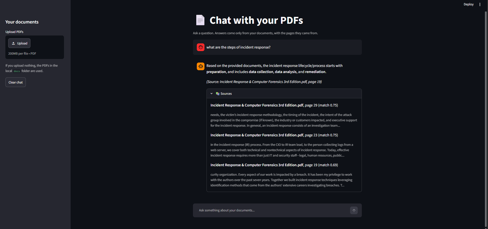

# 📄 Chat with your PDFs (RAG chatbot)

A chatbot that answers questions from your own PDF documents and shows exactly which file and page each answer came from. Built with Retrieval-Augmented Generation (RAG): it finds the relevant passages first, then asks an LLM to answer using only those passages.



## How it works

1. **Read:** extracts text from every page of the PDFs.
2. **Chunk:** splits pages into overlapping pieces of about 800 characters, remembering the file name and page number of each piece.
3. **Embed:** converts each chunk into a vector with the `all-MiniLM-L6-v2` sentence-transformer model.
4. **Retrieve:** for each question, finds the most similar chunks using a FAISS vector index.
5. **Generate:** sends the question and the retrieved chunks to Google Gemini, which is told to answer only from that context (or say it can't find the answer).
6. **Cite:** shows the answer together with the source files, pages and passage previews.

## Tech stack

Python, pypdf, sentence-transformers, FAISS, Google Gemini API, Streamlit

## Project structure

```
rag-chatbot/
├── docs/               # your PDFs for local use (not uploaded to GitHub)
├── images/             # screenshot
├── step1_search.py     # read, chunk, embed and search (runs in the terminal)
├── step2_answer.py     # adds the LLM answer to the search (runs in the terminal)
├── chat_app.py         # Streamlit chat interface
├── requirements.txt
└── README.md
```

## How to run

```bash
# 1. Clone the repo
git clone https://github.com/vaishnavisnb/rag-chatbot.git
cd rag-chatbot

# 2. Create and activate a virtual environment
python -m venv venv
venv\Scripts\activate          # Windows
# source venv/bin/activate     # Mac/Linux

# 3. Install dependencies
python -m pip install -r requirements.txt

# 4. Add your free Gemini API key (from aistudio.google.com)
#    Create a file named .env containing:
#    GEMINI_API_KEY=your_key_here

# 5. Start the app
python -m streamlit run chat_app.py
```

Upload PDFs in the sidebar, or put them in a `docs` folder. Text-based PDFs work best, not scanned images.

## Limitations and next steps

- Each question is answered on its own, so the chatbot does not remember earlier questions.
- Scanned PDFs need OCR before they can be searched.
- Answer quality depends on the retrieved passages. Next steps: re-ranking, tuning the chunk size, and conversation memory.
- Uses the free tier of the Gemini API, which has rate limits and may be busy at times (the app retries automatically). Free-tier data may be used by Google to improve its products, so avoid private documents.

## Author

Vaishnavi · [GitHub](https://github.com/vaishnavisnb)
